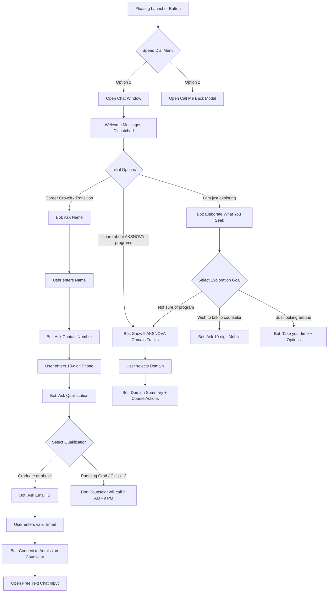

# AKSNOVA Chatbot Documentation

This document provides a comprehensive breakdown of the **AKSNOVA Interactive Career Assistant & Chatbot Widget**, detailing its architecture, conversation logic, user data collection rules, response generation mapping, and integration details.

---

## 1. Overview & Purpose

The **AKSNOVA Chatbot Widget** is an interactive, guided career advising assistant embedded into the public website. Its core purposes are:
1. **Interactive Course Discovery**: Guide prospective students through AKSNOVA's professional diploma programs and advanced IT certifications based on their learning goals and background.
2. **Lead Generation & Counselor Routing**: Collect validated contact details (Name, 10-digit Mobile Number, Email, Highest Educational Qualification) to connect students with live academic counselors.
3. **Instant Callback Service**: Offer a dedicated "Call Me Back" modal with guaranteed callbacks between 9:00 AM and 9:00 PM and direct 24/7 hotline numbers.
4. **Session Continuity**: Retain conversation history and state across tab navigation using browser `sessionStorage`.

---

## 2. File & Directory Structure

The chatbot subsystem consists of three primary files:

```
src/
├── components/
│   └── chatbot/
│       └── ChatbotWidget.tsx        # Main React component (UI, state, conversation engine, modal)
├── data/
│   └── chatbot-courses.ts           # Course definitions, quick-reply options, and copy templates
└── test/
    └── chatbot-widget.test.tsx      # Vitest unit & integration test suite (18+ scenarios)
```

### Component Integration
- **Layout Host**: In `src/layouts/BaseLayout.astro`, rendered as `<ChatbotWidget client:idle />`. Hydrated with `client:idle` to optimize initial page load performance and preserve the static-first architecture.

---

## 3. Architecture & State Management

### 3.1 Key State Variables

| State | Type | Description |
|---|---|---|
| `isOpen` | `boolean` | Controls visibility of the main chatbot window. |
| `isSpeedDialOpen` | `boolean` | Controls the expanded circular speed dial launcher. |
| `isCallbackModalOpen` | `boolean` | Toggles the dedicated "Request a call back" modal. |
| `messages` | `ChatMessage[]` | Chronological list of chat bubbles (`bot` or `user`). |
| `quickOptions` | `string[] \| null` | Pill/button options available for user selection. |
| `isTyping` | `boolean` | Controls animated typing indicator and disables inputs during delay. |
| `chatInputMode` | `"name" \| "phone" \| "email" \| "text" \| null` | Controls which input form is rendered in the bottom tray. |
| `userName` | `string` | Stores collected user full name. |
| `userEmail` | `string` | Stores collected user email address. |
| `phoneNumber` / `chatPhoneNumber` | `string` | Stores collected 10-digit contact numbers. |
| `hasUnread` | `boolean` | Displays animated red pulse notification until first opened. |

### 3.2 Storage Keys (`sessionStorage`)

- `aksnova_chat_welcome_seen_v1`: Marked `"true"` once welcome messages are dispatched to prevent duplicate introductions on page navigation.
- `aksnova_chat_history_v1`: JSON-serialized array of all `ChatMessage` objects in current session.
- `aksnova_chat_options_v1`: JSON-serialized list of currently active quick-reply options.

---

## 4. User Interaction & Conversational Flows

### 4.1 Flow Diagram



---

## 5. Detailed Conversation Branches & Responses Generated

### 5.1 Welcome Sequence
When a user clicks "Chat with us" for the first time:
1. **Message 1 (Immediate)**:
   > "Hey! Welcome to AKSNOVA!  
   >  
   > Ab Aage Ki Socho 🤔💭 and start exploring."
2. **Typing Indicator**: Runs for 1,400ms (`AKSNOVA is typing...`).
3. **Message 2 (After 1.4s)**:
   > "We have a wide range of programs for you across Data Science, Full Stack Development, Cloud Computing, Cyber Security, and Advanced IT Certifications.  
   >  
   > Are you ready to start upskilling?"
4. **Suggested Options Displayed**:
   - `I am looking for career growth/transition`
   - `Learn about AKSNOVA programs`
   - `I am just exploring`

---

### 5.2 Branch A: Career Growth / Transition Flow (Lead Capture)

1. **User clicks**: `"I am looking for career growth/transition"`
2. **Bot replies**:
   > "May I know your name please to begin with?"
   - **Input Tray**: Name input field (`autoFocus`, submit button enabled only when non-empty).
3. **User submits name**: e.g. `"Rahul Sharma"`
4. **Bot replies** (after 600ms delay):
   > "Please provide your contact number."
   - **Input Tray**: Phone input with `🇮🇳 +91` badge (digits only, length 10, cannot start with 0).
5. **User submits phone number**: e.g. `9876543210`
6. **Bot replies** (after 600ms delay):
   > "Please share your highest qualification."
   - **Options displayed**:
     - `Graduate or above`
     - `Pursuing Graduation`
     - `Class 12 or below`

#### Outcome 1: "Graduate or above"
- **Bot replies**:
  > "Please provide your email id for the live chat agent to assist you further. ✍️"
- **Input Tray**: Email input field with live validation formatting.
- **User enters email**: e.g. `rahul@example.com`
- **Bot replies**:
  > "Please wait while I connect you with our Admission Counselor!"
- **Input Tray**: Free-form text input allowing student to send custom queries directly to counselors.
- **User sends text message**:
  - **Bot confirms**:
    > "Thank you for your message! Our Admission Counselor has received your note and will reply shortly."

#### Outcome 2: "Pursuing Graduation" or "Class 12 or below"
- **Bot replies**:
  > "Thank you, {Name}! We have noted your qualification ({Qualification}). Our senior career counselor will connect with you shortly between 9 AM to 9 PM to recommend programs suited to your background."
- **Next Options**:
  - `Explore Courses`
  - `Explore other domains`

---

### 5.3 Branch B: Learn About AKSNOVA Programs

1. **User clicks**: `"Learn about AKSNOVA programs"`
2. **Bot replies**:
   > "We offer comprehensive, career-focused diploma programs and advanced certifications with 250+ hiring partners. Please select domain of your interest to learn more:"
3. **Pills displayed (9 AKSNOVA Domains)**:
   - `Data Science & Analytics`
   - `ML & AI`
   - `Software & Technology`
   - `Cloud Computing & DevOps`
   - `Cyber Security`
   - `Software Testing`
   - `Digital Marketing`
   - `Accounting (Tally & GST)`
   - `Graphic Design & UI/UX`

#### Selecting a Domain
When any domain is selected (e.g. `Data Science & Analytics`), the bot fetches the curated curriculum summary from `DOMAIN_DETAILS`:
- **Bot replies**:
  > "{Domain Summary}  
  >  
  > Would you like to review full curriculum details or connect with our career advisor?"
- **Next Options**:
  - `Explore Courses`
  - `Wish to talk to counselor`
  - `Explore other domains`

---

### 5.4 Branch C: "I am just exploring"

1. **User clicks**: `"I am just exploring"`
2. **Bot replies**:
   > "Could you please elaborate what you are looking for?"
3. **Options displayed**:
   - `Not sure of a specific program`
   - `I'm just looking around`
   - `Wish to talk to counselor`

#### Subsequent actions:
- **`Not sure of a specific program`** $\rightarrow$ Bot replies *"Please select domain of your interest!"* and displays the 9 domain buttons.
- **`I'm just looking around`** $\rightarrow$ Bot replies:
  > "Take your time! You can explore our job-ready diploma courses, student placement records, and free learning roadmaps whenever you're ready."  
  Presents options: `Explore Courses`, `Wish to talk to counselor`, `Explore other domains`.
- **`Wish to talk to counselor`** $\rightarrow$ Bot replies *"Please provide your 10-digit mobile number so our counselor will connect with you."* and opens the phone input form.

---

### 5.5 Branch D: General Navigation Shortcuts

- **`Explore Courses`**:
  > "You can check out our complete course catalog with detailed modules, projects, and roadmaps in our Courses section!"  
  Options: `Wish to talk to counselor`, `Explore other domains`.
- **`Explore other domains`**:
  > "Please select domain of your interest!"  
  Displays all 9 domain pills.

---

## 6. Data Collection & Validation Rules

The widget collects four primary types of prospective learner data:

| Field | Source / Mode | Validation Rules | Sanitization / Handling |
|---|---|---|---|
| **Name** | Chat Name Input Tray | - Minimum 1 non-whitespace character.<br>- Send button disabled until typed. | Stored in React state & `userNameRef`. Trimmed of leading/trailing spaces. |
| **Phone Number** | Chat Counselor Phone Input & Callback Modal | - Exact regex: `/^[1-9][0-9]{9}$/`.<br>- Only numeric digits permitted.<br>- Leading `0` automatically stripped.<br>- Fixed length limit of 10 digits. | Prefixed with `+91` in chat logs. Validates before submit button is enabled. |
| **Email Address** | Chat Email Input Tray | - Regex: `/^[a-zA-Z0-9._%+-]+@[a-zA-Z0-9.-]+\.[a-zA-Z]{2,}$/`.<br>- At least 2-character TLD required. | All whitespace automatically removed on keypress. Lowercased upon submission. |
| **Qualification** | Chat Quick-Reply Pills | - Strict enum selection: `Graduate or above`, `Pursuing Graduation`, `Class 12 or below`. | Recorded directly in chat narrative. |
| **Counselor Query** | Chat Free Text Tray | - Minimum 1 character.<br>- Send button enabled when non-empty. | Appended to conversation log for admission team follow-up. |

---

## 7. "Request a Call Back" Modal Feature

In addition to guided chat, the widget includes a fast-path callback popup:

### UI Features
- Accessible from speed dial by tapping **"Call me back"**.
- Dimmed / dull dark backdrop (`bg-black/60 backdrop-blur-xs`).
- Dismissible via corner close button (`✕`), background backdrop tap, or `Escape` key.
- Phone number input matching the same strict 10-digit validation rules.
- Lists 3 guarantee bullet points:
  1. *Non-biased career guidance*
  2. *Counselling based on your skills and preference*
  3. *No repetitive calls, only as per convenience (9 AM to 9 PM)*
- **Direct Support Helplines**:
  - 🇮🇳 Indian Nationals: `1800 210 2020` (`tel:18002102020`)
  - 🌐 Foreign Nationals: `+91 8045604032` (`tel:+918045604032`)

### Success Confirmation State
Upon submitting a valid number:
- Displays a custom emerald green **scalloped 3D rosette badge** with white checkmark.
- Header: `"Thanks for update"`
- Subtitle: `"Out team will reach out to you shortly"`
- Auto-dismisses the modal after 3.5 seconds.

---

## 8. Accessibility & UX Enhancements

- **ARIA Roles & Semantics**:
  - Widget wrapper: `<aside aria-label="Website Chatbot Assistant">`
  - Chat panel: `role="dialog"` with `aria-labelledby="chatbot-title"`
  - Message stream: `role="log"` with `aria-live="polite"`
  - Modal dialog: `role="dialog"` with `aria-modal="true"`
- **Keyboard Navigation**:
  - Full keyboard tab traversal across all buttons and inputs.
  - `Escape` key immediately closes the active modal, chat window, or speed dial.
- **Auto-scroll**:
  - Automatically scrolls to the newest message whenever bot responds, typing begins, or new options render.
- **Mobile Responsive**:
  - Fixed positioned in bottom-right corner with responsive offsets (`bottom-20` on mobile to avoid overlapping navigation bars, `bottom-6` on desktop).
  - Width adapts cleanly from full mobile screen width (`calc(100vw - 2rem)`) to fixed `410px` on desktop.

---

## 9. Automated Testing & Quality Assurance

The widget is covered by **Vitest & React Testing Library** in `src/test/chatbot-widget.test.tsx`:
- Initial rendering, floating trigger, and notification badge tests.
- Two-step welcome sequence timing and typing indicator lifecycle.
- Complete branching flows:
  - `"I am just exploring"` $\rightarrow$ `"Not sure of a specific program"` $\rightarrow$ Domain list.
  - `"I am looking for career growth/transition"` $\rightarrow$ Name $\rightarrow$ Phone $\rightarrow$ Qualification $\rightarrow$ Email.
  - `"Learn about AKSNOVA programs"` $\rightarrow$ Domain cards $\rightarrow$ Course routing.
  - Callback modal opening, input validation, submission, and auto-dismissal.
  - Session persistence in `sessionStorage` and `Escape` key dismissal.

---

*Document created for AKSNOVA Edutech engineering and product teams.*
